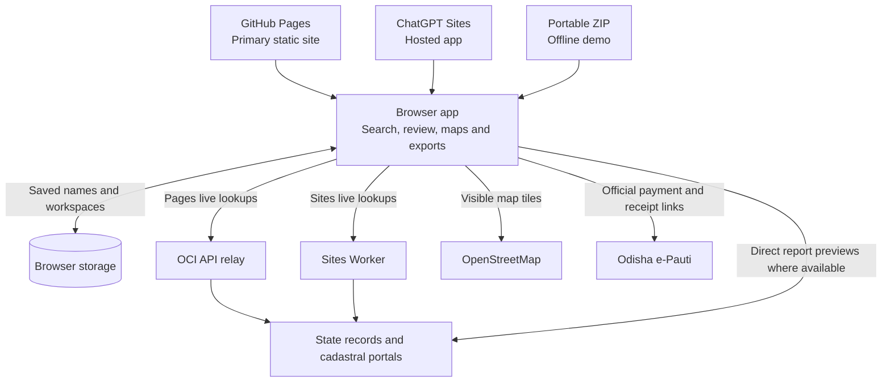

# India Land Search

India Land Search helps people find villages, review name spellings, and inspect
land records without an app account. Start with a name, village, plot number,
or khata number. Compare the results with the official source and export the
records you need.

[Open GitHub Pages](https://suryanjena.github.io/india-land-search/) · [Open ChatGPT Sites](https://landreview-odisha.thinwave16.chatgpt.site/) · [Download the latest portable release](https://github.com/SuryaNJena/india-land-search/releases/latest)

## Government data notice

Official land records and cadastral maps displayed here come from the relevant government portals. India Land Search claims no ownership of that data and has obtained no separate licence to reuse it. The data is shown only for the contest demonstration. For authoritative records and permitted reuse, consult the issuing government authority and its published terms. [Data sources and terms](docs/DATA-SOURCES.md)

## Get started

- **Find a village or search a name.** Start on **Home**. Choose one or more villages from the atlas or the name picker. Use **Start with a name** for a guided search, or visit **Name Matching** to edit and save spellings using the Odia keypad.
- **Inspect a known plot or khata.** Open **Plot Records** for BhuNaksha Plot Info and a shaded sheet preview. Use **Records of Rights** for the front page, plot schedule, and printable PDF.
- **Explore maps and dues.** **Village Maps** combines an OpenStreetMap atlas with native cadastral sheets. Pick or switch villages without entering portal codes. In Odisha, start a name scan when you want to highlight matches on the active sheet. **Land revenue** opens the official Odisha e-Pauti payment or receipt service and shows the holding details to enter.
- **Try it with sample records.** On a hosted site, choose **Take a tour**. For the offline demo, extract the release ZIP, run `node serve.mjs` with Node.js 24, and open the URL printed in the terminal.

Live coverage varies by state. Odisha has village-scoped name lookup, plot records and maps. Chhattisgarh, Bihar and Uttar Pradesh have pilot parcel lookup and map tools. Statewide live name-only search needs an authorised production dataset. See the coverage table below. [User manual](docs/USER-MANUAL.md) · [Data coverage and attribution](docs/DATA-SOURCES.md)

## Architecture

The browser handles imports, local matching, saved data, and exports. Live
queries send the selected lookup inputs to the official sources through the
appropriate adapter or direct report route. The portable build includes bundled
reference data and fictional records. [Developer guide](docs/DEVELOPER-GUIDE.md)

## Documentation

| Read this | For |
| --- | --- |
| [User manual](docs/USER-MANUAL.md) | Searching, map review, RoR exports, payment handoff, and troubleshooting |
| [Developer guide](docs/DEVELOPER-GUIDE.md) | Local setup, runtime paths, verification, and releases |
| [Deployment runbook](docs/DEPLOYMENT.md) | GitHub Pages, ChatGPT Sites, and OCI operations |
| [Changelog](CHANGELOG.md) | Live-site changes and the features in each tagged download |
| [Contributor guide](AGENTS.md) and [Codex evidence](docs/CODEX-EVIDENCE.md) | Repository conventions and project evidence |

[MIT licence for project code](LICENSE) · [Source data licences](docs/DATA-SOURCES.md)

## State and territory coverage

Ordered by depth of integration. Reference districts and village outlines come
from dated datasets. Administrative reorganizations may be newer than these
layers. A dash means that feature is unavailable in the app or unverified.
**Portal** opens the state’s own map viewer. Compatible imports and local
name review are available across states. [Source data and attribution](docs/DATA-SOURCES.md)

| State or union territory | District map | Village suggestions | District → village outlines | Cadastral maps | Plot Info | Records |
| --- | --- | --- | --- | --- | --- | --- |
| Odisha | Yes | Yes | Yes | Live vector | Live | Village name lookup and RoR |
| Chhattisgarh | Yes | Yes | Yes | Live vector | Live | Exact Bhuiyan link |
| Bihar | Yes | Yes | — | Live vector | Live | Official records portal |
| Uttar Pradesh | Yes | Yes | — | Live raster | Live | Official records portal |
| Jharkhand | Yes | Yes | — | Portal | — | Official records portal |
| Rajasthan | Yes | Yes | — | Portal | — | Official records portal |
| Andaman and Nicobar Islands | Yes | — | — | — | — | Official records portal |
| Andhra Pradesh | Yes | — | — | Portal | — | Official records portal |
| Arunachal Pradesh | Yes | — | — | — | — | DILRMP directory |
| Assam | Yes | — | — | — | — | Official records portal |
| Chandigarh | Yes | — | — | — | — | Official records portal |
| Dadra and Nagar Haveli and Daman and Diu | Yes | — | — | — | — | DILRMP directory |
| Delhi | Yes | — | — | — | — | Official records portal |
| Goa | Yes | — | — | Portal | — | Official records portal |
| Gujarat | Yes | — | — | Portal | — | Official records portal |
| Haryana | Yes | — | — | — | — | Official records portal |
| Himachal Pradesh | Yes | — | — | Portal | — | Official records portal |
| Jammu and Kashmir | Yes | — | — | — | — | Official records portal |
| Karnataka | Yes | — | — | — | — | Official records portal |
| Kerala | Yes | — | — | — | — | Official records portal |
| Ladakh | Yes | — | — | — | — | Official records portal |
| Lakshadweep | Yes | — | — | — | — | DILRMP directory |
| Madhya Pradesh | Yes | — | — | — | — | Official records portal |
| Maharashtra | Yes | — | — | Portal | — | Official records portal |
| Manipur | Yes | — | — | — | — | DILRMP directory |
| Meghalaya | Yes | — | — | — | — | DILRMP directory |
| Mizoram | Yes | — | — | — | — | DILRMP directory |
| Nagaland | Yes | — | — | — | — | DILRMP directory |
| Puducherry | Yes | — | — | — | — | DILRMP directory |
| Punjab | Yes | — | — | — | — | Official records portal |
| Sikkim | Yes | — | — | — | — | DILRMP directory |
| Tamil Nadu | Yes | — | — | — | — | Official records portal |
| Telangana | Yes | — | — | — | — | Official records portal |
| Tripura | Yes | — | — | — | — | Official records portal |
| Uttarakhand | Yes | — | — | — | — | Official records portal |
| West Bengal | Yes | — | — | — | — | Official records portal |

Live holding-name matching is village-scoped in Odisha. The other pilot
states link to their government records portals for holder searches. The
Land revenue tab provides Odisha e-Pauti links.
Use the [state integration checklist](docs/STATE-INTEGRATION-CHECKLIST.md) to add or extend a state.
