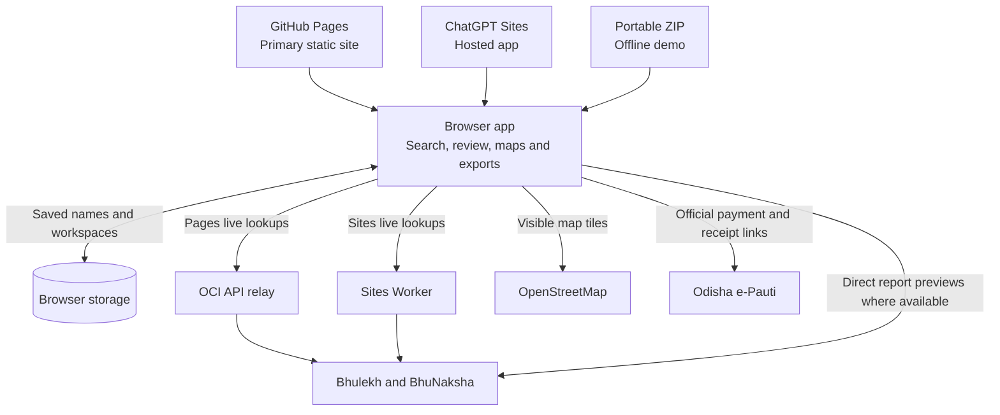

# India Land Search

India Land Search helps people find villages, review name spellings, and inspect
land records without an app account. Start with a name, village, plot number,
or khata number. Compare the results with the official source and export the
records you need.

[Open GitHub Pages](https://suryanjena.github.io/india-land-search/) · [Open ChatGPT Sites](https://landreview-odisha.thinwave16.chatgpt.site/) · [Download the portable demo](https://github.com/SuryaNJena/india-land-search/releases/latest)

## Get started

- **Find a village or search a name.** Start on **Home**. Choose one or more villages from the atlas or the name picker. Use **Start with a name** for a guided search, or visit **Name Matching** to edit and save spellings using the Odia keypad.
- **Inspect a known plot or khata.** Open **Plot Records** for BhuNaksha Plot Info and a shaded sheet preview. Use **Records of Rights** for the front page, plot schedule, and printable PDF.
- **Explore maps and dues.** **Village Maps** combines an OpenStreetMap atlas with native cadastral sheets. **Land revenue** opens the official Odisha e-Pauti payment or receipt service and shows the holding details to enter.
- **Try it with sample records.** On a hosted site, choose **Take a tour**. For the offline demo, extract the release ZIP, run `node serve.mjs` with Node.js 24, and open the URL printed in the terminal.

Live integrations cover Odisha at village, sheet, plot, and khata level. Other
states and union territories have official links in **State portals**, and
local search works with compatible imports. An empty village selection supports
a search of loaded records. Statewide live name-only search needs an authorised
production dataset. [User manual](docs/USER-MANUAL.md) · [Data coverage and attribution](docs/DATA-SOURCES.md)

## Architecture

The browser handles imports, local matching, saved data, and exports. Live
queries send the selected lookup inputs to the official sources through the
appropriate adapter or direct report route. The portable build includes bundled
reference data and fictional records. [Developer guide](docs/DEVELOPER-GUIDE.md)

## Documentation

| Read this | For |
| --- | --- |
| [User manual](docs/USER-MANUAL.md) | Searching, map review, RoR exports, payment handoff, and troubleshooting |
| [Developer guide](docs/DEVELOPER-GUIDE.md) | Local setup, runtime paths, verification, and releases |
| [Deployment runbook](docs/DEPLOYMENT.md) | GitHub Pages, ChatGPT Sites, and OCI operations |
| [Changelog](CHANGELOG.md) | Live-site changes and the features in each tagged download |
| [Contributor guide](AGENTS.md) and [Codex evidence](docs/CODEX-EVIDENCE.md) | Repository conventions and project evidence |

[MIT licence for project code](LICENSE) · [Source data licences](docs/DATA-SOURCES.md)
