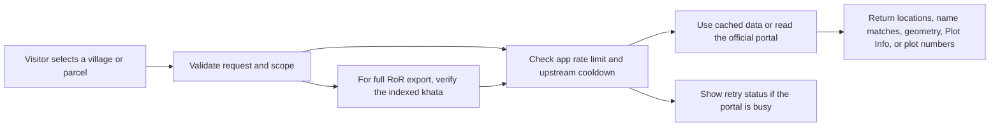

# Anonymous Odisha lookups

## CP1 Explain

The ChatGPT Site home page is public. The app adds an identity check to a live
village search, location selection, map details, and the RoR plot schedule.
This change removes that check so signed-out visitors can use the same official
Odisha lookup workflow.

Keep explicit village and parcel validation, same-origin requests, existing
portal throttles, exact parcel verification, and the indexed check for full
RoR export. The statewide search still depends on coverage in the index.

## CP2 Diagram

## CP3 Test

The worker regression reproduces the failure without an identity header for
both directory and map requests. It also checks the complete village, parcel,
and plot-schedule workflow, the explicit location requirement, and the origin
check.

## CP4 Fix

The Worker no longer requires ChatGPT visitor identity for public Odisha
lookups. Cached sheet responses can be served during other requests and the
same Worker instance runs one live BhuNaksha map or Plot Info lookup at a time.
Full hosted RoR export still verifies a khata against the loaded index.

## CP5 Pull request

All 44 tests, the offline verifier, both builds, Pages smoke, and the Chromium
fixture passed. The browser test selects a village and searches for a fictional
name without a ChatGPT identity, then checks there is no sign-in link. The
evidence image is `06-anonymous-live-odisha.png`.
