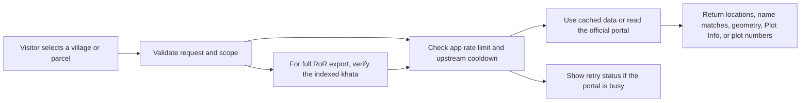

# Anonymous Odisha lookups

## CP1 Explain

The ChatGPT Site home page is public. The app adds an identity check to a live
village search, location selection, map details, and the RoR plot schedule.
This change removes that check so signed-out visitors can use the same official
Odisha lookup workflow.

Keep explicit village and parcel validation, same-origin requests, existing
portal throttles, exact parcel verification, and the indexed check for full
RoR export. The statewide search still depends on coverage in the index.

## CP2 Diagram

