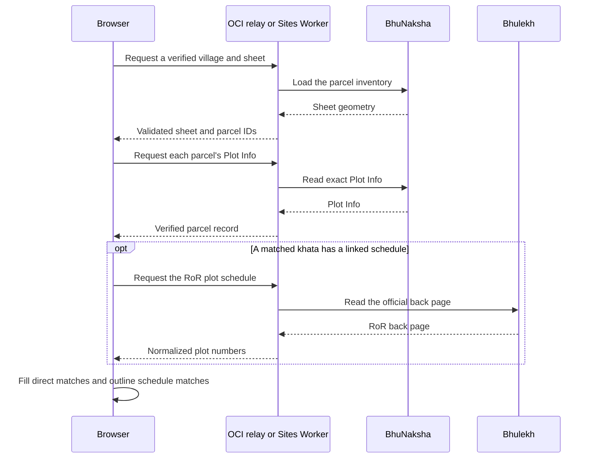

# India Land Search developer guide

Start with the [contributor guide](../AGENTS.md) and [user manual](USER-MANUAL.md).
The browser code is tracked under `dist/`. Node.js 24 builds the current front
end without installing package dependencies. Playwright is used separately for
browser verification.

## Build, run, and verify

Run from the repository root.

```sh
node --test
node verify.mjs
node build-pages.mjs
node scripts/smoke-pages.mjs
node scripts/package-release.mjs ./artifacts/LandReview-portable.zip
```

Build without `LANDREVIEW_API_BASE` when packaging the portable ZIP. Extract it
and run `node serve.mjs` in the extracted folder. For a source-tree preview,
serve `pages-out/` over HTTP.

```sh
node --input-type=module -e "import {serveRelease} from './scripts/serve-release.mjs'; const {url} = await serveRelease('./pages-out', 8080); console.log(url.href);"
```

Browser checks need Playwright and Chromium. The verification workflow installs
Playwright 1.56.1. Set `LANDREVIEW_PLAYWRIGHT` to its absolute `index.mjs` path and
run `node scripts/smoke-browser.mjs`. Optionally set `LANDREVIEW_CHROME` to an
existing Chrome executable and `LANDREVIEW_SMOKE_EVIDENCE` to an output
directory. Default checks use fictional or recorded fixtures. [Test plan](TEST-PLAN.md)

## Where to make changes

| Area | Entry points and responsibilities |
| --- | --- |
| Navigation and views | `dist/index.html`, `dist/app.mjs`, `dist/field-panorama.css` |
| Names and search | `dist/home-search.mjs`, `dist/name-library.mjs`, `dist/name-review.mjs`, `dist/search.mjs`, `dist/core.mjs` |
| Location and maps | `dist/shared-villages.mjs`, `dist/location-atlas.mjs`, `dist/parcel-basemap.mjs`, `dist/live-odisha-map.mjs`, `dist/maps.mjs` |
| Plot and RoR review | `dist/odisha-lookup.mjs`, `dist/plot-profile.mjs`, `dist/live-ror.mjs` |
| Persistence and exports | `dist/files.mjs`, `dist/lookup-workspace.mjs`, `dist/offline-worker.js` |
| Official lookups | `worker/odisha.mjs` contains shared source adapters. `backend/server.mjs` hosts the Node relay. `backend/locality-index.mjs` stores validated location menus. |
| Builds and checks | `build-pages.mjs`, `build.mjs`, `tests/`, `scripts/`, `.github/workflows/` |

## Runtime and data boundaries

| Build | Live lookup path | Storage |
| --- | --- | --- |
| GitHub Pages | `build-pages.mjs` sets the HTTPS `LANDREVIEW_API_BASE` origin. The browser calls the OCI relay for selected Odisha lookups. Linked report previews can also read the official Bhulekh page directly. | Imported records, saved lookups, and names live in the browser. Downloads are saved to the user's device. OCI persists official location menus for up to 30 days and uses bounded, short-lived caches for source responses. |
| ChatGPT Sites | `build.mjs` bundles the same frontend into a Worker that handles same-origin queries. The optional D1 statewide index is a separate data dependency. | Browser storage applies per origin. The current public release has no populated statewide ownership index. |
| Portable ZIP | The static build runs the fictional demo and loaded-record review locally. Official links need a network connection. | The ZIP ships with bundled reference assets and dated geometry for selected sheets. |

The OCI relay exposes `GET /healthz` and validates JSON POST routes below
`/api/odisha/`. `locations` and `map-locations` resolve the official hierarchies.
`tenant-search` searches one village for selected spellings. `maps` provides
sheet lists, parcel geometry, layer metadata, or exact Plot Info. `ror` returns
an official report page or the plot schedule. See the [source interface
reference](ODISHA-OFFICIAL-INTERFACES.md) and [data licences](DATA-SOURCES.md).

## Live parcel scan



The scan starts with the visible sheet and uses a paced queue with up to two
active reads. Requests for the same parcel can share one read. Handle official
cooldowns and retain the distinct meanings of direct text matches and
khata-only matches. A geographic overlay requires verified WGS84 placement.

## Validation before release

1. Keep the CP1–CP5 checkpoints traceable and merge changes through a PR. Run the verification workflow and inspect its browser screenshots for visible changes.
2. Verify the primary [GitHub Pages site](https://suryanjena.github.io/india-land-search/). The Pages workflow deploys app changes from `main`. Publish the same reviewed source to the existing [ChatGPT Site](https://landreview-odisha.thinwave16.chatgpt.site/) when updating the hosted build.
3. Run the OCI health and known-locality checks when changing the relay. Use the dedicated [OCI runbook](https://github.com/SuryaNJena/india-land-search/tree/main/backend/deploy/oci).
4. Tag the reviewed revision when publishing a new portable release. The tag workflow builds, tests, and attaches `LandReview-portable.zip`. Use that archive for distribution. The release job compares an existing attachment byte for byte against the runner build.
5. Record what is in the tagged ZIP and what is only on the live sites in the [changelog](../CHANGELOG.md). See the [deployment runbook](DEPLOYMENT.md) for operations and rollback.

Diagram blocks use GitHub’s Mermaid renderer with an accessible title and
description. The user manual keeps task steps separate from implementation
details. [GitHub Mermaid guide](https://docs.github.com/en/get-started/writing-on-github/working-with-advanced-formatting/creating-diagrams) · [Mermaid accessibility](https://mermaid.js.org/config/accessibility.html) · [Diátaxis](https://diataxis.fr/)
