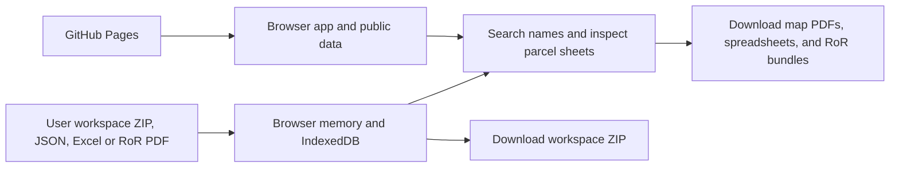

# Standalone GitHub Pages release

## CP1 Explain

GitHub Pages is the production host. The app must run without a ChatGPT account,
a Site Worker, D1, an external map service, or a configurable API origin.
Users can search imported ownership records, locate Odisha villages, inspect and
highlight map parcels, and assemble PDFs inside the browser.

Ownership search covers the loaded records. GitHub Pages provides static files,
so obtaining fresh government records and installing a verified statewide
dataset are separate from running the app. The site may show official links
for deliberate navigation. Personal records and saved RoRs stay in IndexedDB
and user-owned workspace ZIPs.

## CP2 Diagram

Existing v1 workspace ZIPs retain geometry, name rules, and RoR documents when
moved between origins. Geography supplied through an uploaded WGS84 file is
drawn locally. The Pages build disables hosted lookups and refuses cross-origin network resources through a browser content security policy. The separate hosted build keeps its signed-out government lookup.

## CP3 Test

The baseline failed the Pages smoke check for the local-only content policy.
The browser regression imports a fixture workspace, searches loaded records,
zooms and inspects the matched plot, places a local pin, and reloads the workspace.
The geometry tests cover exact identity and use of imported geometry without a fetch.

## CP4 Fix

Publish only browser assets, vendored libraries, the Odisha place catalogue,
and public geometry. The launch workflow builds and publishes from merged
source changes. Live government retrieval becomes links to the official
sites and deliberate imports. A public geometry snapshot cannot supply
ownership records or statewide coverage.

## CP5 Pull request

All 44 tests, the offline verifier, and the smoke checks on the extracted
portable release passed. Chromium verified local search, map inspection,
name highlights, pin placement, persisted imports, and PDF exports with
zero external requests. The packaged release also passed with the old index
origin environment variable set, because the build no longer reads it.

### Conflict resolution with the signed-out release

The Pages runtime disables hosted lookups, and only the Pages build injects its
local-only content policy. The hosted app retains its existing signed-out
Bhulekh search and BhuNaksha map flows. Both browser paths have independent
regression coverage. The reconciled branch passed all 46 Node tests, the
offline verifier, the Sites build, the extracted Pages smoke check and Chromium.
