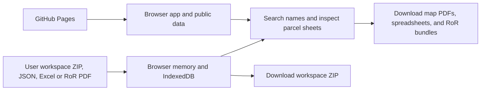

# Standalone GitHub Pages release

## CP1 Explain

GitHub Pages is the production host. The app must run without a ChatGPT account,
a Site Worker, D1, an external map service, or a configurable API origin.
Users can search imported ownership records, locate Odisha villages, inspect and
highlight map parcels, and assemble PDFs inside the browser.

Ownership search covers the loaded records. GitHub Pages provides static files,
so obtaining fresh government records and installing a verified statewide
dataset are separate from running the app. The site may show official links
for deliberate navigation. Personal records and saved RoRs stay in IndexedDB
and user-owned workspace ZIPs.

## CP2 Diagram

Existing v1 workspace ZIPs retain geometry, name rules, and RoR documents when
moved between origins. Geography supplied through an uploaded WGS84 file is
drawn locally. The Pages build excludes legacy hosted modules and refuses
cross-origin network resources through a browser content security policy.
