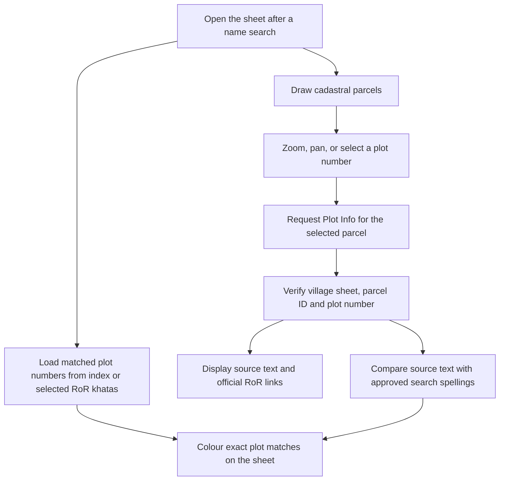

# Interactive Odisha plot map

## CP1 Explain

People can select a parcel today, but the live sheet only outlines it and displays
its number. The official BhuNaksha interface also shows Plot Info and RoR links.

- Zoom and pan the sheet, fit it again, and display readable plot numbers when
  zoomed in. Support looking up an exact plot number, including subdivisions.
- Fill the selected parcel and show its official Plot Info and RoR links when
  BhuNaksha returns them. Keep the selection visible when details are unavailable.
- Apply exact plot-number highlights from matched land records. Compare the Plot
  Info opened in the viewer with the approved search spellings as additional
  evidence. Keep the distinction between selected and matched parcels visible.
- Load parcel details on demand. Use existing official RoR schedules to resolve a
  small set of matching khatas when opening a scoped search map.

## CP2 Diagram

The browser supplies a parcel ID and plot number. The Worker constructs the GIS
code, contacts the district's official server, and checks all three fields on the
response. The canvas and PDF share the same confirmed match set.

## CP3 Test

The four focused tests reproduced the missing Plot Info lookup, route validation,
viewport controls, and parcel-level matching. Chromium exercises the zoom controls,
label threshold, direct canvas click, exact plot search, both match sources, and
the official RoR link shown in the details panel using fictional records.

## CP4 Fix

The results map now loads Plot Info for one selected parcel at a time. It uses
the index when plot numbers are available or resolves up to three matching khatas
automatically on map open. Larger sets can be checked in batches of up to 12.
The browser compares details opened in the map with the approved name variants.

## CP5 Pull request

All 36 tests, the offline verifier, the ChatGPT Sites Worker build, the Pages
build and smoke check, and the Chromium smoke passed. The browser evidence
artifact includes the screenshot `04-interactive-odisha-map.png`.
