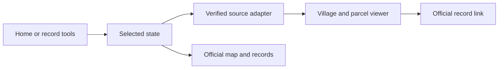

# Multi-state source pilot

## CP1 Explain

Keep the existing journey from village and name review to matched parcels and
government records. Start with Chhattisgarh, Bihar, Jharkhand, Rajasthan and
Uttar Pradesh. Enable each live capability when its source and identifier
mapping are verified. Provide official map and records links for blocked steps.

## CP2 Diagram

## CP3 Acceptance

- The five state entries route to the intended official sources.
- The relay accepts only configured states and hierarchical selection codes.
- Leading zeros survive state menu and map requests.
- Parcel rendering uses exact source parcel IDs and labels the source.
- A source failure stays visible and retains official links.
- Odisha and the fictional demo keep their existing search behavior.
