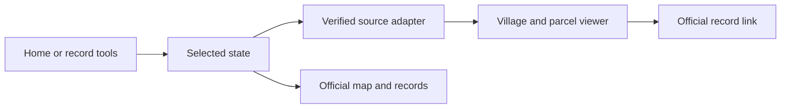
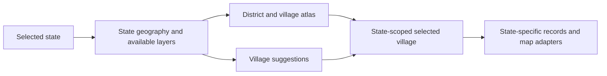

# Multi-state source pilot

## CP1 Explain

Keep the existing journey from village and name review to matched parcels and
government records. Start with Chhattisgarh, Bihar, Jharkhand, Rajasthan and
Uttar Pradesh. Enable each live capability when its source and identifier
mapping are verified. Provide official map and records links for blocked steps.

## CP2 Diagram

## CP3 Acceptance

- The five state entries route to the intended official sources.
- The relay accepts only configured states and hierarchical selection codes.
- Leading zeros survive state menu and map requests.
- Parcel rendering uses exact source parcel IDs and labels the source.
- A source failure stays visible and retains official links.
- Odisha and the fictional demo keep their existing search behavior.

## CP4 Verified source coverage

| State | Pilot coverage | Remaining step |
| --- | --- | --- |
| Chhattisgarh | In-app village maps, highlighting by exact khasra number, Plot Info, and a deep link to Bhuiyan's exact khasra record. | Validate the village name-search service and B-I/P-II document labels. |
| Bihar | In-app village maps, highlighting by exact plot number, and Plot Info. | Complete the holder-name search and security code on BiharBhumi. The automated name-to-map join is still unverified. |
| Jharkhand | Official Jharbhoomi Register-II and BhuNaksha links. | The BhuNaksha map and parcel responded in Windows with ordinary OS TLS. The relay's Node TLS rejects the map host. Jharbhoomi requires user verification. |
| Rajasthan | Official Apna Khata and BhuNaksha links. | Apna Khata requires permission to reproduce its contents. The official public viewer returned 503 during testing. |
| Uttar Pradesh | In-app official village map image and exact plot highlight, with Plot Info and UP Bhulekh handoff. | The public raster path supports one plot highlight at a time. Bulk vector geometry and the name-to-map join remain unverified. |

Manual source checks used Adhchara in Chhattisgarh, Azamnagar in Bihar, Barkani
in Jharkhand, and Akbarpur in Uttar Pradesh. The relay does not index owners.
Government links leave verification and document access on the state portals.

- [Chhattisgarh BhuNaksha](https://bhunaksha.cg.nic.in/bhunaksha/) and [Bhuiyan](https://bhuiyan.cg.nic.in/)
- [Bihar BhuNaksha](https://bhunaksha.bihar.gov.in/10/indexmain.jsp) and [Jamabandi](https://emutation.bihar.gov.in/biharBhumireport/ViewJamabandi)
- [Jharkhand BhuNaksha](https://jharbhunaksha.jharkhand.gov.in/) and [Jharbhoomi](https://jharbhoomi.jharkhand.gov.in/MISRegister2/DistrictMap.aspx)
- [Apna Khata policy](https://apnakhata.rajasthan.gov.in/privacy_policy.html) and [Rajasthan BhuNaksha](https://bhunaksha.rajasthan.gov.in/Viewmap/)
- [UP BhuNaksha](https://upbhunaksha.gov.in/) and [UP Bhulekh](https://upbhulekh.gov.in/)

The Pages deployment needs the updated OCI image for the new
`POST /api/state-maps` route. The Sites build bundles this route. The portable
build links to the official portals and retains its offline workspace tools.

## State-aware location discovery

### CP1 Explain

The atlas currently opens district polygons only for Odisha. Village suggestions
use one Odisha directory even when another state is selected, and shared village
selection can carry Odisha identifiers into other state tools.

### CP2 Diagram

### CP3 Coverage

- Chhattisgarh exposes sourced districts and a reference village directory.
- Identical locality IDs in separate states retain separate selections.
- Shared tabs use the selected state's capabilities and labels.
- Odisha's verified portal crosswalk and lookup remains available.

## CP4 Evidence for location discovery

The five pilot directories were built from open NWDP geography, with 20,335
named Chhattisgarh entries and searchable catalogs for Bihar, Jharkhand,
Rajasthan and Uttar Pradesh. Reference village boundaries load on demand in
Odisha and Chhattisgarh. Other pilot states show reference district boundaries
and directory results. The shared discovery and official lookup controls carry
the selected state. See the [state integration checklist](STATE-INTEGRATION-CHECKLIST.md)
for the remaining steps toward full parity for every state.
