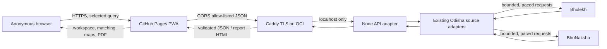

# OCI Public Odisha API

## CP1 — Explain

GitHub Pages is an HTTPS static site. The Odisha portals do not consistently
allow browser cross-origin reads, so the browser cannot reliably retrieve live
tenant lists, map geometry, Plot Info, or RoR HTML by itself. This small OCI API
is a controlled HTTPS relay for those live requests. It does not make a
statewide name index and it must not imply that Odisha-wide name-only search is
available: Bhulekh's public tenant search still starts with a village.

The API runs on the existing `carenest-landing` Always Free VM in
`ap-hyderabad-1`. The separate `postgres` VM is out of scope and must remain
untouched. Before any reconfiguration, the original 47 GB boot volume was
preserved as the OCI backup `carenest-landing-before-india-land-search-2026-11-26`.
The application snapshot is rollback material; it is not mounted by the new
service. OCI reports the snapshot as Always Free retained.

The browser sends only a selected location, search spellings, map sheet / plot,
or a khata and page side. The relay validates the route and identifiers, uses
the official Bhulekh/BhuNaksha host allow-lists in `worker/odisha.mjs`, and
returns the response. Portal cookies remain in short-lived process memory.
Existing bounded in-memory caches reduce repeated source calls. The app does
not write tenant names, requests, or portal responses to a database or disk.

`LANDREVIEW_PAGES_ORIGIN` restricts browser-readable CORS responses to the
configured Pages origin. CORS is not authentication, so the service also has a
per-IP request limit, bounded request bodies, source concurrency / pause rules,
no arbitrary-URL proxy, and no request-body access logs. No ChatGPT login,
Cloudflare Worker, database, or paid API is required by this path.

## CP2 — Diagram

The API host is `https://api.129.154.35.213.nip.io`; its DNS name points to the
VM's current public address and Caddy manages HTTPS. Keep the OCI public IP
stable while this hostname is configured. The browser continues to keep saved
workspaces, name matching, map coloring, and exports locally.

## CP3 — Test

Default tests use synthetic responses and must not call public government
portals. They cover exact-origin CORS and preflight, invalid origins, bounded
request bodies, request-rate limiting, village search, map / Plot Info reads,
and RoR front/back retrieval without a statewide index. A live health check
must not fetch source data. Do not use repeated production probes to tune portal
rate limits.

## CP4 — Fix

The Pages adapter uses an explicit, build-time `apiBase`. The OCI service binds
only to loopback behind Caddy; Caddy forwards only the configured API hostname
and overwrites the client-IP header. The VM keeps the installed operating
system, Caddy, SSH, Oracle Cloud Agent, and host security controls. Replacing
the CareNest application means removing its app container and `/srv/carenest-vm`
content and replacing its routes; it does not mean deleting the VM, boot volume,
network, or the separate PostgreSQL instance.

## CP5 — Pull request and deployment

Merge the feature through the repository PR before switching the live Pages
build. The GitHub Pages workflow publishes the public API URL as a non-secret
repository variable. The VM deployment installs only the API source adapter,
Node service, and Caddy API route. Keep the pre-change OCI boot-volume backup
until the new endpoint and Pages workflow pass their smoke checks. Roll back by
restoring the snapshot and the backed-up Caddy configuration.

### Free-tier and operational limits

OCI lists two `VM.Standard.E2.1.Micro` instances (each 1/8 OCPU and 1 GB RAM)
as Always Free, plus five volume backups and 200 GB of combined boot/block
volume storage. Always Free does not provide an uptime guarantee; out-of-host
capacity and idle-instance reclamation are possible. Treat public portal
availability, access rules, licensing, and load limits as independent of OCI
free status. See [OCI Always Free resources](https://docs.oracle.com/en-us/iaas/Content/FreeTier/freetier_topic-Always_Free_Resources.htm)
and [Oracle Free Tier](https://www.oracle.com/cloud/free/).
