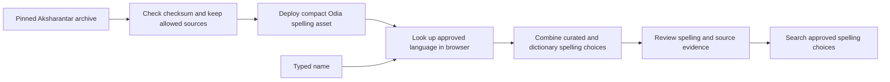

# Free Odia spelling dictionary

## CP1 Explain

Use a public-domain subset of AI4Bharat Aksharantar to offer more English-to-Odia spelling matches in the name review. Use training and validation rows marked Wikidata, Samanantar, or IndicCorp. The data card and publication distinguish these mined pairs from the other subsets.

Bundle the dictionary with the app and look up entries in the browser. The dictionary lookup needs no account, API key, billing, or personal name requests to a third party. Each card should distinguish dictionary spellings from the exact count found in loaded land records. Preserve curated spellings, the letter variants, and explicit approval. The corpus contains ordinary words and place names as well as personal names.

## CP2 Diagram

## Rebuild

Download the [pinned Odia archive](https://huggingface.co/datasets/ai4bharat/Aksharantar/blob/b311c19b4a66bfac52ca4d95456b4b5646aca49e/ori.zip) and run `python scripts/build-odia-dictionary.py <path-to-ori.zip>` from the repository root. The script checks the archive SHA-256 before reading it. Source selection and attribution are documented in [data sources](DATA-SOURCES.md).

## CP5 Pull request evidence

The browser review uses 81,198 lookup keys and 83,664 spelling pairs. The table loads only when a name in Roman script is entered for Odia review. It is about 670 kB when compressed with gzip. The generated file reproduced byte-for-byte. The tests check real lookup pairs, preserved spelling combinations, and the distinction between dictionary evidence and saved record evidence. The signed-out Chromium smoke confirms the dictionary uses a static same-origin GET with an empty query and body.
