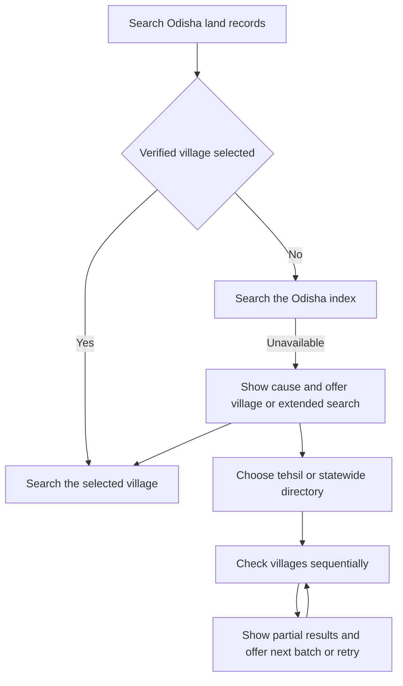

# Odisha live search fallback

## CP1 Explain

If the statewide index is unavailable, explain that it returned no search result. Use an already verified Bhulekh village when the user has one. Let the user choose a village or explicitly start an extended lookup in a tehsil or throughout Odisha.

The extended lookup walks Bhulekh's district, tehsil and village lists. It checks one village at a time, waits for the user after every 10 completed or unavailable villages, and retains partial results in the current tab. A rate limit or connection failure pauses the lookup at the current village. Report coverage and unavailable villages alongside matches.

Live lookup uses the existing hosted Bhulekh connector. The standalone GitHub Pages build continues to offer its local workspace and official portal links.

## CP2 Diagram

## CP5 Pull request evidence

The signed-out browser check uses synthetic Bhulekh responses. It verifies direct village selection, the missing-index message, the village finder, explicit batches, retry at the same village, and cumulative reporting of results and unavailable villages. A throttled village does not extend the batch beyond ten distinct villages.

The unit suite, verification script, Sites bundle, and portable Pages and Chromium checks passed locally. The browser test sends no requests to government portals.
