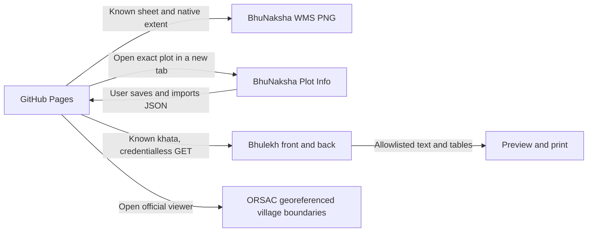

# Odisha government source interfaces

## CP1 Explain

India Land Search can keep live access to the government sources on GitHub
Pages wherever the portal permits the browser to read the response. Lookups
start with a selected sheet or a known khata. No ownership index is necessary
for those operations. Statewide searches by name need a source that supports
that query or supplied records to search locally.

### BhuNaksha Odisha

The master entry is [BhuNaksha Odisha](https://bhunakshaodisha.nic.in/bhunaksha/).
Its [public viewer code](https://bhunakshaodisha.nic.in:8443/bhunaksha/index.js)
uses the district's assigned host. The original browser requests use the
following form or query fields. These are observed interfaces.

| Operation | Endpoint | Fields | Response and browser use |
| --- | --- | --- | --- |
| Discover levels | POST `rest/Levels/count` and `rest/Levels/ListsAfterLevel` | State and selection level | The viewer builds the district through sheet hierarchy. |
| Sheet dropdown | POST `ScalarDatahandler` | `OP=2`, `state=21`, `level=5`, `selections=D,T,R,V` | HTML selector `level_5`. Chromium cannot read these cross-origin responses. |
| Sheet extent | POST `rest/MapInfo/getVVVVExtentGeoref` | `state=21`, `gisLevels=D,T,R,V,S,`, `srs=0` for the native sheet | `gisCode`, attribution, scale and bounds. Native coordinates may be in a local grid. Use WGS84 only when verified. |
| Parcel geometry | POST `rest/MapInfo/getVillageGeoJSon` | `state=21`, `giscode`, `noCompress=true` | GeoJSON features with parcel `id` and plot `kide`. Cross-origin body is unavailable. |
| Village raster | GET `WMS` | WMS 1.3.0 `GetMap`, `VILLAGE_MAP`, `gis_code`, `state=21`, native `BBOX`, `CRS=`, `WIDTH`, `HEIGHT`, `FORMAT=image/png` | Browser can display the PNG as an image. Its pixels remain origin-restricted, so this does not make an interactive parcel vector layer. |
| Selected raster | GET `WMS` | `PLOT_LIST`, `STYLES=PLOT_SELECTION`, `plot_id`, `gis_code`, same extent and dimensions | Official viewer uses this overlay after it has verified a parcel ID. |
| Click a parcel | POST `rest/MapInfo/getPlotAtXY`, GET `ScalarDatahandler` with `OP=4` | `state`, `giscode` or `levels`, native `x,y` | Viewer resolves an ID and obtains record text. Body is not a browser-readable cross-origin interface. |
| Exact plot number | GET `ScalarDatahandler` | `OP=5`, `state=21`, `levels=D,T,R,V,S,`, `plotno` | `has_data`, `ID`, `gisCode`, `plotNo`, `info`, `plotInfoLinks`. Use a top-level link or import a saved response. |
| Detail by parcel ID | POST `rest/MapInfo/getPlotInfo` | `state`, `giscode`, `plotid`, `plotno`, `attrs` | Returns an identity, text and report links. Verify all identity fields. |
| Additional layer lists | POST `rest/Layers/getLayers` | `state`, `giscode`, `layerType` of `TABLE_THEMES`, `TABLE_LAYER_MASTER`, or `TABLE_DERIVED_LAYERS` | Viewer metadata. Layer names and georeferencing can vary. |

For the screenshot's codes `4/1/1/1/01` on 25 November 2026, assigned port 8443
returned geometry and exact plot 58 details. Standard port 443 returned empty
bodies for those two routes. The tested BhuNaksha responses carried no CORS allow
origin and the viewer advertised `X-Frame-Options: SAMEORIGIN`. Chromium at
`https://suryanjena.github.io` rejected a Plot Info fetch and loaded a 640-pixel
WMS PNG. The app opens the official plot response in another tab and can read a
user-saved JSON file only after checking the sheet and plot. Saved files are
browser-local and user-provided.

### Bhulekh Odisha

The [official report finder](https://bhulekh.ori.nic.in/RoRView.aspx) is an
ASP.NET Web Forms application. A fresh request may redirect to
`BhulekhError.aspx`, which offers a session restart. For the tenant flow, follow
the district, tahasil, and village selectors and then choose Tenant. The viewer
posts fresh `__VIEWSTATE` and `__EVENTVALIDATION` fields with the appropriate
`__EVENTTARGET`. Control suffixes observed by LandReview are `ddlDistrict`,
`ddlTahsil`, `ddlVillage`, `rbtnRORSearchtype`, and `ddlBindData`. Session cookies
and portal-origin form transactions matter. The timeout response advertised
`Access-Control-Allow-Origin: *` and `X-Frame-Options: DENY` but supplied no tenant
options. The browser cannot use wildcard CORS to read a credentialed request.

The report route is HTTPS GET `/ViewRoR.aspx` with `DistCode`, `TehCode`,
`VillCode`, `KhataNo`, and `type=front|back`. Both sides returned report HTML
and wildcard CORS for the known khata linked by the screenshot's Plot Info.
An actual credentialless Chromium request from GitHub Pages read the back page
and its `#gvRorBack` plot table. The frontend reads one selected khata, checks
for the official report markers, copies only safe text/table elements, and
offers the pages in the same order for PDF printing. A failed request leaves
official navigation available. A report URL is not a statewide name API.

### ORSAC Odisha Know Your Land

The [official KYL viewer](https://www.odishakyl.in/mapview.php) offers district,
block, GP and village selection. [ORSAC's 4K Geo description](https://odisha4kgeo.in/index.php/cms/aboutus)
documents georeferenced administration and cadastral data, along with WMS/WFS
services. Direct scripted requests to the KYL landing page and viewer with
the Pages origin returned HTTP 403 during the probe. Publicly indexed viewer
content confirmed the controls, but no browser-readable, reusable boundary
feed was verified. Use the viewer for boundary inspection. Before integrating
an ORSAC layer, verify its documented endpoint, coverage, CRS, allowed origin,
and terms. Join village boundaries using an official code crosswalk. Keep
survey village sheet grids and ORSAC geographic boundaries in their respective
coordinate systems until a verified transform is available.

### Request policy

Perform a lookup only after the user submits the location, plot, or khata.
Pause between the two report requests. Stop on rejection, rate limits, timeout,
or validation failure. No automatic retries or background crawling. Never
render raw portal HTML or commit captured record text. Browser `no-cors`
responses are [opaque](https://fetch.spec.whatwg.org/). A public page may be
viewable in a tab while its response remains unavailable to cross-origin script.

## CP2 Diagram

## CP3 Test

The regression suite checks the assigned host, WMS extent and overlay, exact
plot identity, official report links, anonymous CORS requests, and early
stop on throttle. Chromium exercises the source panel with fictional responses
and checks that embedded report resources remain inert.

## CP4 Fix

The source panel opens from Home for Odisha and from State portals. Verified
village selections prefill source codes. A loaded sheet can show the official
selected-plot PNG after the corresponding saved Plot Info is checked.
Bhulekh reports are read directly, previewed, and printable.

## CP5 Pull request

All 45 automated tests, both builds, the offline verifier, Pages smoke, and
Chromium passed. Live probes confirmed base and selected BhuNaksha images,
a blocked cross-origin Plot Info fetch, and a browser-readable Bhulekh report.
Browser evidence includes `06-odisha-official-sources.png`.

### Integration with the standalone Pages release

The Pages build uses its browser-only runtime and permits only the required
Bhulekh report origin and district BhuNaksha image origins. The hosted app
retains signed-out village lookup. Chromium passed the imported workspace,
native WMS, exact Plot Info import, direct RoR and signed-out hosted fixtures.
After integrating the spelling and dictionary branches, all 56 Node tests, the verifier, both builds, and the Pages and Chromium smoke checks passed.
