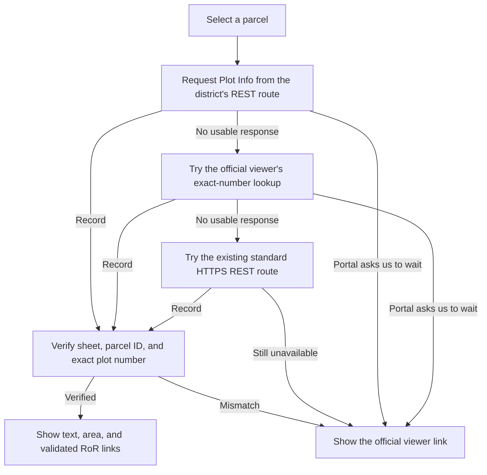

# Odisha Plot Info retrieval

## CP1 Explain

The hosted map showed a generic Plot Info error for plot 1228. For the matching
Kapaleswar parcel on sheet 01, the district's assigned server returned verified
details from both its REST route and the lookup used by the official map viewer.
The same routes on standard HTTPS returned empty responses during the probe.

The details panel should try the viewer lookup when REST supplies no usable
record, keep exact parcel validation, and offer the district's official viewer
when both lookups fail. The host-side cause of the original failure is unverified.

## CP2 Diagram

## CP3 Test

Four regression cases failed on the original reader. They cover an empty REST
response, parcel and subdivision mismatches, rate limits, and explicit no-data.

## CP4 Fix

The fallback uses the same district, tehsil, RI, village, and sheet selection as
the official viewer. Both formats undergo the same parcel identity checks. The
panel provides the district viewer link and the selected village, sheet, and
plot number if the app cannot retrieve the details.

## CP5 Pull request

All 42 automated tests, the offline verifier, the Sites Worker build, the Pages
build and smoke test, and the Chromium smoke test passed. With the REST response
simulated as empty, the new reader recovered Plot Info and both official RoR
links for Kapaleswar sheet 01, plot 1228 over the public viewer endpoint.
Browser evidence includes `05-plot-info-fallback.png` using fictional records.
