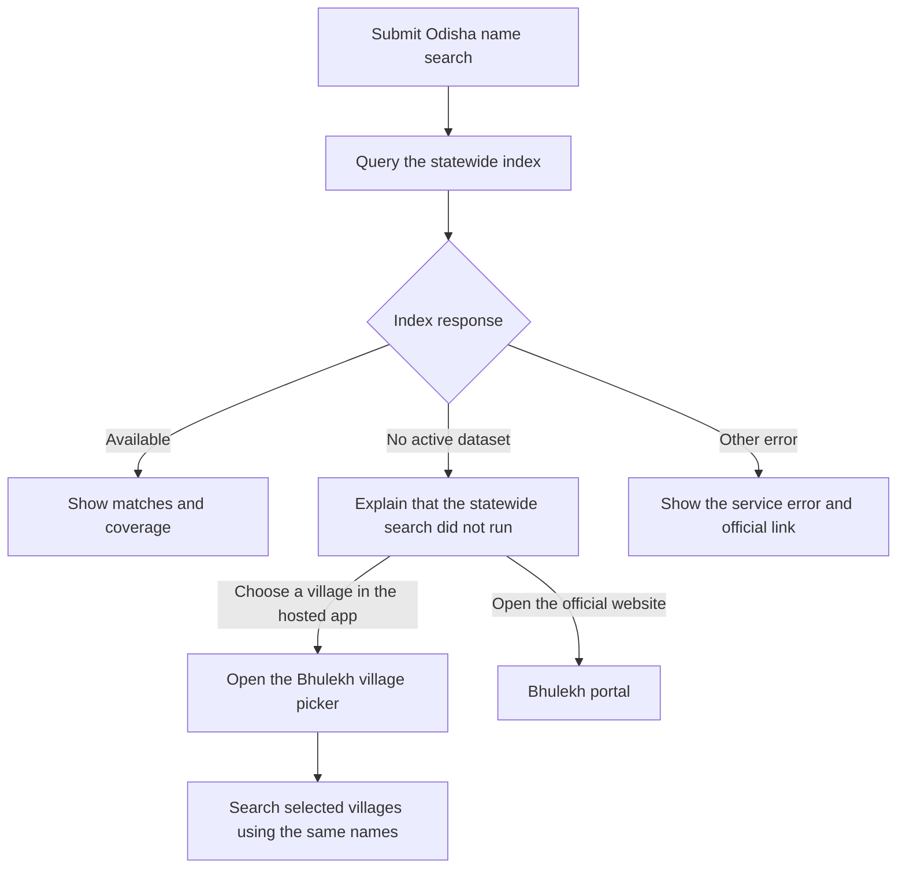

# Odisha search when the statewide index is unavailable

## CP1 Explain

On 25 November 2026, an Odisha search with a fictional name and no village returned
HTTP 503 from the hosted index route. The screenshot displays the same response.
The deployed database has no active statewide index. This is an unavailable search,
so the user has received no finding about the name.

- State that the statewide search did not run and explain why in plain language.
- Keep the entered names and approved variants. On the hosted app, offer a direct
  way to open the official village picker for a scoped live search.
- Keep the official Bhulekh link available. Statewide name-only search still depends
  on loading a verified production dataset.

## CP2 Diagram

