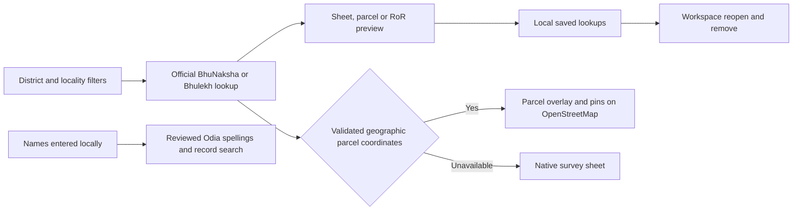

# Standalone Odisha lookups and Workspace

## CP1 Explain

Village maps, Plot records, Records of Rights and Name matching should each open in an empty browser. Pick a location before requesting a map or a record. Use the official sheet and plot endpoints for BhuNaksha, and use Bhulekh’s location and khata codes for Records of Rights. Existing imported workspaces still support matched maps, filters, Excel and PDF export.

Keep the GitHub Pages build static. When an official browser response is readable, use it directly. Preserve official links and a clear path to native WMS where browser cross-origin rules limit automatic discovery. The hosted build can use its existing same-origin connector. Place parcels over OpenStreetMap only when the official geometry or a verified geographic file supplies valid coordinates. A native survey grid remains usable in the sheet viewer.

Automatically add successful standalone map sheets, Plot Info and both RoR pages to local Workspace storage. Each item can be reopened, selected and removed. Keep the old workspace format and storage identifiers compatible. Update public branding to India Land Search.

Chrome’s built-in Translator documentation does not list Odia. Use the local Aksharantar dictionary, curated variants and phonetic rules for Odia name suggestions.

## CP2 Diagram

## Browser and portal checks

| Area | GitHub Pages local workflow | Additional capability on the existing hosted connector |
| --- | --- | --- |
| Location filters and labels | Bundled directory and 53,320 reference village shapes across 30 districts. Confirmed Bhulekh codes are filled where the crosswalk matches. Other villages can use their official codes. | Official BhuNaksha and Bhulekh cascading dropdowns. |
| Village sheets | Interactive dated geometry for bundled sheets and exact official GeoJSON imports. Direct WMS displays the native sheet or a known layer where the source provides extent metadata. | Automatic live sheet directory, vector geometry and layer metadata. |
| Plot records | Exact official plot response opens in a separate tab. A saved response can be verified and shown with the plot. | Direct Plot Info reads and one fresh public session after explicit expiry. |
| Records of Rights | Direct browser reads of both known-khata pages, front and back preview, and print to PDF. | Both lookup builds use the direct report flow. The existing hosted search can also discover holdings using the official Bhulekh form. |
| Name matching and local Workspace | Browser dictionary, curated rules, autosaved plot text, reopen and delete, map and RoR exports. | Existing optional live tenant searches and indexed lookup. The index still requires authorized statewide data. |
| Geographic map | OpenStreetMap supports the surveyed village outline, pins, and validated WGS84 parcel imports. | Official parcels or WMS if source metadata verifies the projection and bounds. |

Bharatapada (Cuttack 3, Mahanga 11, Kurujanga RI 8, village 102), sheet 01, plot 9 returned valid Plot Info from the assigned BhuNaksha host at port 8443 without a session refresh. With the Pages origin, it returned HTTP 200 with no cross-origin permission header. The native sheet exposed seven optional layers and no geographic placement. Both linked Bhulekh report pages returned HTTP 200 with wildcard CORS. The live probes retained availability metadata only.

A fresh browser session cannot grant a Pages script permission to read an origin-restricted response. The Pages workflow keeps official navigation and validates an imported response. Boundary and native parcel coordinates are kept in their respective coordinate systems. [Browser cross-origin rules](https://developer.mozilla.org/en-US/docs/Web/HTTP/Guides/CORS) · [Chrome Translator supported languages](https://developer.chrome.com/docs/ai/translator-api#supported-languages)

The Odisha boundary asset rebuild uses the public `vb_soi_or_geojson.zip` resource from the [National Water Data Portal catalogue](https://nwdp.nwic.gov.in/dataset/village-boundary). Run `python scripts/build-odisha-boundaries.py <path-to-zip>` with Shapely and pyproj. The script pins the archive SHA-256 and filters the output to labelled reference geometry and verified location codes.
