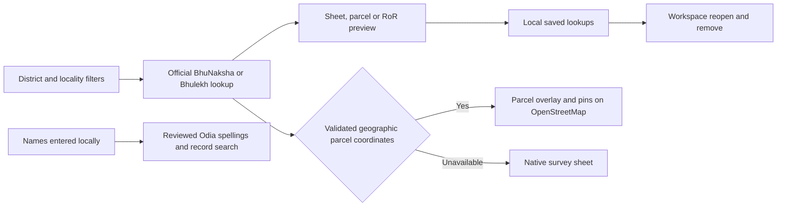

# Standalone Odisha lookups and Workspace

## CP1 Explain

Village maps, Plot records, Records of Rights and Name matching should each open in an empty browser. Pick a location before requesting a map or a record. Use the official sheet and plot endpoints for BhuNaksha, and use Bhulekh’s location and khata codes for Records of Rights. Existing imported workspaces still support matched maps, filters, Excel and PDF export.

Keep the GitHub Pages build static. When an official browser response is readable, use it directly. Preserve official links and a clear path to native WMS where browser cross-origin rules limit automatic discovery. The hosted build can use its existing same-origin connector. Place parcels over OpenStreetMap only when the official geometry or a verified geographic file supplies valid coordinates. A native survey grid remains usable in the sheet viewer.

Automatically add successful standalone map sheets, Plot Info and both RoR pages to local Workspace storage. Each item can be reopened, selected and removed. Keep the old workspace format and storage identifiers compatible. Update public branding to India Land Search.

Chrome’s built-in Translator documentation does not list Odia. Use the local Aksharantar dictionary, curated variants and phonetic rules for Odia name suggestions.

## CP2 Diagram

