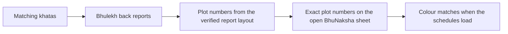

# India Land Search test plan

## Run the suites

Use Node.js 24 from the repository root.

```sh
node --test
node verify.mjs
node build.mjs
```

For the optional import and export parity check, run `node verify.mjs <path-to-Odisha-workspace.zip>` against the separately stored local workspace. The default tests use synthetic or saved public geometry fixtures and make no government portal requests.

## Automated baseline

Characterization tests capture behavior in the current release so changes can be deliberate. Unit tests cover focused logic. The default suite does not certify the future launch scope.

| Tests | Behavior verified | Requirements |
| --- | --- | --- |
| `UT-01`–`UT-02` | Unicode normalization, whole-token matching, and separate surname and full-name flags | BR-03, TR-03 |
| `UT-03` | Source-label evidence and optional local filtering | BR-07, TR-07 |
| `UT-04` | Alternate name orders and multiword middle names | BR-03, TR-03 |
| `UT-05`–`UT-08` | Scoped coverage, jurisdiction attribution, parcel identity, and validated RoR links | BR-04, BR-06, BR-07, TR-03, TR-04, TR-06, TR-07 |
| `UT-09`–`UT-11` | Odia initial combinations, middle names, local-script aliases, and exact occurrence counts | BR-03, TR-03 |
| `UT-12`–`UT-13` | Sequential traversal of the official village list and resuming a failed branch | BR-06, TR-04, TR-08 |
| `UT-14`–`UT-15` | Local lookup of source-backed Odia spellings, language scope, and preserved curated variants | BR-03, TR-03 |
| `CT-01`–`CT-03` | Current sign-in and village rules, matched fields and links, cached source reuse, and unavailable versus zero results | BR-04, BR-06, TR-04, TR-06 |
| `CT-04` | Dated fallback maps stay within the requested village and sheet | BR-05, TR-05 |
| `CT-05`–`CT-07` | Workspace v1 preservation, checksum rejection, and local front-before-back merge | BR-07, TR-07 |
| `CT-08` | The current Bhulekh connector cancels a throttled lookup and suppresses another upstream call during its local cooldown | BR-06, TR-08 |

Keep `CT-01` as the characterization of the signed-in village connector. When anonymous statewide search ships, give its public route its own acceptance test.

## Challenge release acceptance

`tests/demo.test.mjs` checks village-scoped synthetic matching, duplicate khatas, missing and single-sided documents, and map page count. The Actions browser smoke checks location autofill, spelling review, search, and downloaded PDFs under the portable release subpath. It also checks all four Odia spelling combinations, exact local evidence and direct village lookup when the hosted connector is available. The unavailable-index fixture verifies that extended lookup waits for consent, retries the same village on a throttle and stops after 10 villages per batch. It fails on browser errors or outbound traffic. The expected files are one colored map page and four RoR pages for two fictional khatas.

## Pending production acceptance

| ID | Scenario and expected outcome | Requirement |
| --- | --- | --- |
| AT-01 | In a clean signed-out browser, enter a name and select Odisha with no locality. Receive results from a verified statewide index without uploading a file or being redirected to sign in. | BR-01, BR-02 |
| AT-02 | Seed records across multiple districts and simulate a missing or stale district. Report the coverage accurately. An incomplete search must not display a statewide no-match outcome. | BR-02, BR-06 |
| AT-03 | Type a three-part name, review a local-script reversed order, and search. Unchecked suggestions are excluded. Select all and Clear all include and exclude the expected variants. | BR-03 |
| AT-04 | Search a common name with holdings in different villages. Each result shows the approved public fields and the correct plots and official links. An unresolved plot or khata is flagged. | BR-04 |
| AT-05 | Open a matched village map and change sheets. Show a source date for a saved map and an official link if geometry is unavailable. | BR-05 |
| AT-06 | Select two distinct khatas and duplicate a multi-plot selection. Produce one PDF that includes each khata once, with its entire front followed by its entire back. | BR-05 |
| AT-07 | A selected khata has a missing or unmergeable page. Identify the affected khata. Do not present a partial artifact as the complete selected set. | BR-05, BR-06 |
| AT-08 | Repeat public searches under expected peak load. Measure response time, concurrency, debounce/rate-limit behavior, and upstream request volume against agreed targets. | BR-01, BR-06 |
| AT-09 | Simulate a throttled or temporarily unavailable portal with `Retry-After` in seconds and HTTP-date formats. Confirm all acquisition jobs for that portal honor the wait, keep their checkpoints, and resume without duplicating finished villages. Verify an access denial stops acquisition for review. | BR-02, BR-06, TR-08 |
| AT-10 | In a fresh browser, search a village with no person's name or location filters. Verify local-script and known Latin spellings, disambiguate same-name villages, and confirm that selection fills only verified filters. Confirm no land-record portal requests occur during discovery. | BR-08, TR-09 |

## Standalone Odisha lookup acceptance

Start in an empty browser. Use Name matching, pick Bharatpada from labelled village outlines, and open the saved cadastral sheet from Pages. Check the zoom controls inside the map, the official layer menu and exact Plot Info link, two direct report reads, local matching on the saved plot, and reopen and remove all saved items after reload. Test the portable app shell after disconnecting Chromium. The hosted fixtures cover the native layer catalogue, exact identity checks, public session renewal, and denial and throttle handling.

## GitHub Pages smoke check

Serve the static build at a repository subpath. Verify that assets load, village lookup and local workspace import work, and official portal links are visible. With no search API configured, confirm that village lookup sends no requests to Site Worker routes. If live search is enabled, verify the Pages origin and run the signed-out search flow against the configured API.

## Automatic colouring on live village maps

In a consolidated Bhulekh back report, column 8 is a consolidation block number. Columns 9 and 10 contain the plots inside and outside those blocks. The regular report uses column 8 for plot numbers. Reading the block number as a plot number can colour an unrelated parcel and leave the real match blank until Plot Info is opened.



`tests/live-map-matches.test.mjs` covers both layouts, Odia digits, exact subdivisions and exclusion of consolidation block numbers. The browser fixture checks that a map with four matching khatas colours the scheduled parcels before any Plot Info call.

## Plot text beyond the tenant directory

A tenant option contains a listed name and khata. A parcel's Plot Info can also name a parent or co-holder. For Bharatapada sheet 01, the queried parent spelling occurs in plot 43 and the back schedule for khata 150 includes 43, but its tenant options omit that parent. The geometry response supplies an ID and number with empty plot text.

    Open search map → colour tenant-hit schedules → check remaining numbered parcels
    Plot Info name match → colour exact parcel → look up discovered khata → colour scheduled plots

The browser regression must detect a Plot Info match outside the tenant hits and colour a sibling parcel from its khata without selecting any plot. Changing or closing the sheet must stop further background lookups.

## CP1 · Name Matching and demo navigation

Home searches records by name and place. Name Matching manages the spellings
used in a search. It must support Odia input, review variants without a
workspace, and retain the existing rematching rules for imported records.
The standalone demo has a visible exit on every tab. Its brand link returns
to the public homepage, while the embedded tour uses its own controls.

## CP2 · Name review flow

    Name Matching → type or edit names → review spellings → save to this browser
                                                        → use on Home → search records
    Standalone demo → exit or brand link → normal Home
