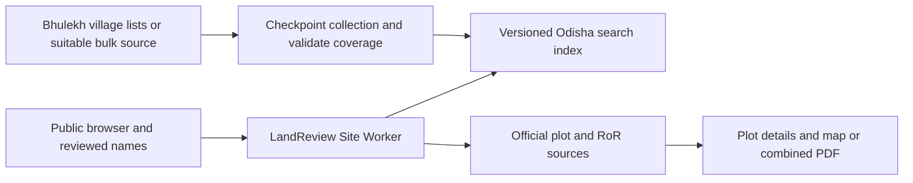

# LandReview technical requirements

**Status** Draft for design review. The shipped baseline and proposed launch changes are identified separately. See the [BRD](BRD.md) for stakeholder decisions.

## Shipped baseline

- The ChatGPT Site serves browser ES modules under `dist/` through the Worker assembled by `build.mjs`. Name suggestions use Sanscript and curated rules. The browser computes name variants, applies user selections, and stores imported workspaces in IndexedDB.
- `worker/odisha.mjs` serves same-origin `POST /api/odisha/locations`, `/tenant-search`, and `/maps`. The current routes require a Site identity. Searches use district, tehsil, and village codes and return the match, source coverage, and official RoR links when a usable khata number is available.
- Map results use BhuNaksha sheet coordinates. The published viewer can use dated, geometry-only snapshots for Bharatapada and Anda sheets 01–03. A map outage outside saved coverage provides the official portal link.
- Workspace ZIP v1 verifies declared entry sizes and SHA-256 hashes. Existing local PDF assembly copies a selected front document followed by the selected back document. The live tenant flow supplies links.

## Proposed launch design

| ID | Technical requirement | Business requirement |
| --- | --- | --- |
| TR-01 | Add an anonymous search route backed by a verified Odisha index. Retain same-origin request validation, bounded query sizes, pagination, and rate controls. Determine capacity limits through load testing after the source is agreed. | BR-01, BR-02, BR-06 |
| TR-02 | Build the Odisha index from a suitable bulk source or a verified village-by-village collection. Reconcile results against the official village catalogue. Track source identifiers, collection date, district coverage, and rejected rows. Activate a verified version atomically and retain the last usable version if the refresh fails. Choose storage after measuring record count, growth, and query load. | BR-02, BR-06 |
| TR-03 | Preserve original name strings and query approved variants as alternatives using Unicode-aware matching. Keep names, scopes, and matches distinct across states and localities. Deduplicate repeated variants without merging homonyms. | BR-03, BR-04 |
| TR-04 | Join a tenant match to plots and RoR by verified source identifiers. Use jurisdiction and source locality codes plus the exact khata string as the holding key. Use a source parcel ID or a verified sheet-and-plot identifier for each parcel. Show links, freshness, and any unresolved joins. | BR-04, BR-05 |
| TR-05 | Load geometry by official village and sheet and make source dates visible. Use one selected holding list for PDF assembly. Deduplicate by holding key, preserve selection order, and write the complete front followed by the complete back for each holding. Report missing or unmergeable pages before presenting a combined file as complete. Preserve signed originals. | BR-05, BR-06 |
| TR-06 | Return distinct states for successful zero matches, incomplete coverage, upstream failure, throttling, and invalid input. Expose source coverage and freshness in the response. Keep raw upstream responses, credentials, uploaded records, and unnecessary personal fields out of public API responses and logs. | BR-01, BR-04, BR-06, BR-07 |
| TR-07 | Keep the existing local import and export formats compatible. Preserve checksum rejection, original identifiers, review labels, and front-before-back ordering. | BR-07 |
| TR-08 | Reuse the public portal's normal read-only request sequence. Start the acquisition pilot with one request in flight per portal and measure throughput. Share a cooldown across jobs and host aliases for the same portal. Honor `Retry-After` on throttled or temporarily unavailable responses. Pause the job for operator review if the portal denies access or introduces an interactive challenge. | BR-02, BR-06 |
| TR-09 | Ship a versioned village directory that can be searched in the browser, with Odisha first and the same format for other states. Key entries by stable locality ID and retain verified names, aliases, state, district, and tehsil. Rank exact matches ahead of prefixes, use the selected state as an optional filter, and distinguish same-name villages by jurisdiction. Fill the RI and connect live search only where the necessary portal mappings are verified. | BR-08 |

## Optional GitHub Pages build

Use the same browser modules for ChatGPT Sites and GitHub Pages. The Pages build uses paths relative to the repository subpath and packages the public village directory with the static app. The default Pages configuration provides directory lookup, portal links, and local workspace tools. Enable live search only with a configured HTTPS API that serves the verified index and supports the Pages origin. Do not package credentials, private workspace data, or tenant records in the Pages build. Publish through a manual GitHub Actions deployment once the public repository is ready. [GitHub Pages hosting](https://docs.github.com/en/pages/getting-started-with-github-pages/what-is-github-pages)

Use the [Local Government Directory](https://data.gov.in/catalog/local-government-directory-lgd) for the administrative hierarchy. Keep LGD locality IDs separate from Bhulekh and BhuNaksha identifiers and verify the crosswalk against the Odisha portals. Keep the RI empty where the mapping has not been verified. The village directory can answer place searches without contacting the land-record portals or importing a workspace.

## Odisha source strategy

- **Bhulekh finds candidate holdings.** Traverse the official district, tehsil, and village selectors in the public session. Collect the tenant list at village scope and keep the source khata and locality codes. Serve statewide name queries from the resulting index so each public search puts no acquisition load on the portals. Retrieve the official RoR for the holdings the user selects.
- **BhuNaksha supplies parcel and map data.** Use the district map host and village or sheet codes. Fetch parcel details as needed for matching holdings, and cache geometry by sheet. Verify joins against source identifiers before attaching details to a holding.
- **Measure before expanding.** Verify the portal's conditions for automated collection and public reuse. Run a bounded pilot, log request counts and outcomes, checkpoint completed villages, and estimate refresh time before scaling. A successful one-village request is evidence of endpoint behavior. Statewide coverage and a sustainable refresh cadence each require their own evidence. [HTTP `Retry-After`](https://www.rfc-editor.org/rfc/rfc9110.html#section-10.2.3)
- **Observed source check on 24 November 2026.** Bharatapada 102 returned 2,549 Bhulekh tenant options over six HTTP requests. Three BhuNaksha requests returned three sheet IDs and 302 inventory entries and 302 map features for sheet 01. This check ran directly from the workspace. Hosted live geometry has previously been unreliable and the Site has dated map fallbacks.

## Verification and unresolved dependencies

- The [test plan](TEST-PLAN.md) maps characterization and unit tests to these requirements and identifies launch cases that remain pending.
- The statewide acquisition path's access terms, schemas, coverage, and refresh frequency must be verified before TR-01, TR-02, and the live plot/PDF flow can be accepted. The current village connector stays useful for source verification and scoped fallback.
- Confirm anonymous traffic limits and document retention after source and volume are known. Combined PDFs should carry source references so users can reopen the official records.
