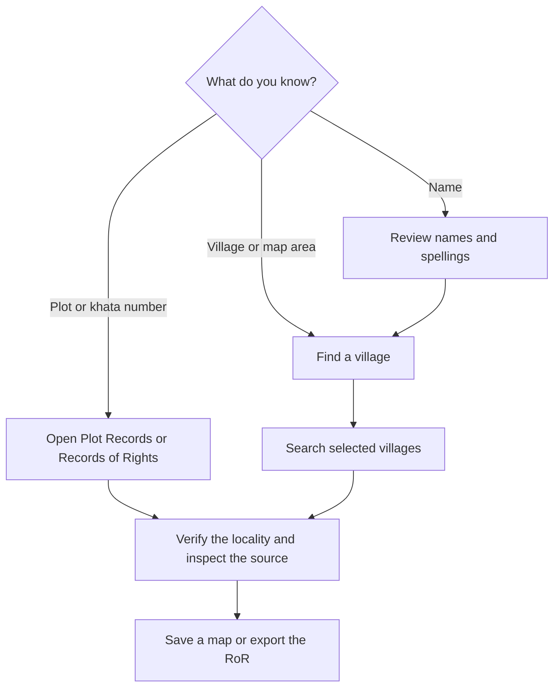

# India Land Search user manual

[Open GitHub Pages](https://suryanjena.github.io/india-land-search/) or use [ChatGPT Sites](https://landreview-odisha.thinwave16.chatgpt.site/).
You can start a live Odisha lookup without importing a workspace. Use **Take a
tour** to practise with fictional records. The standalone demo also opens from
the URL printed by the portable ZIP. Click the **×** or India Land Search logo
to leave it.

## Find land records by name

1. Open **Home**. Choose **Find villages** to start with a place or **Start with a name** for the guided search.
2. Enter a name or surname. Check the suggested spellings and name orders that match your intent. **Name Matching** lets you type in Odia, edit the list, and save it in this browser. Select **Use on Home** to carry the reviewed list into your search.
3. Type a village name or find it on the atlas. In Odisha, click a district to see its villages, or use the district dropdown. Select one or more villages. If there are several possible official matches, verify the district and tahasil before choosing.
4. Run the search. For a live Odisha search, use the selected villages. To search loaded or saved records, choose the state and filter by location as needed.
5. Open a matching khata, inspect an individual plot, or open the linked BhuNaksha map. Compare the spelling and record details with the official source.

## Read a plot, a map, or a RoR

| Task | Where to go |
| --- | --- |
| Find a known plot | Open **Plot Records**, choose the village and sheet, and enter the plot number. The map shades the matching parcel when the sheet is available. Expand **Recorded holders and holding details** or **RoR plot schedule** to read its linked Bhulekh record. |
| View a village or sheet | Open **Village Maps**. Use the atlas for village boundaries and reference pins. Open its BhuNaksha sheet for exact plot numbers, native coordinates, and PDF export. |
| Inspect coloured results | Open **BhuNaksha village map** from a name search. A filled parcel has a direct text match. An outlined parcel belongs to a matching khata schedule. Progress appears as Plot Info is checked. Use **Pause** and **Resume checking** as needed. |
| View or print an official RoR | Open **Records of Rights**, choose a village, and enter the khata number. Choose **Load front and back**, then **Print both sides / Save PDF**. In live search, selected khatas can be printed together where both official reports are available. |
| Export imported records | Choose **Plot Records** for an Excel export, **Village Maps** for matched sheet PDFs, or **Records of Rights** for selected saved PDF documents. |
| Add verified geographic parcels | Under **Parcel overlay on the atlas**, add WGS84 GeoJSON for the current sheet with its `giscode` and official parcel IDs or plot numbers. The atlas can also show an official geographic layer where available. |

The shaded parcel is a map reference. Confirm the plotted parcel and recorded
holders against the official source. A name in a parent field also counts as a
text match. Expand **Jaati · as recorded** where the native Plot Info provides it.

## Pay Odisha land revenue or find a receipt

1. Open **Land revenue** from the sidebar, a plot, or a RoR. The holding summary shows the district, tahasil, village, and khata when you opened it from a record.
2. Choose **Open e-Pauti payment**. Enter the holding on e-Pauti and review the demand, including water tax where the portal lists it.
3. Enter the CAPTCHA and complete the payment on the official site. Use **Check payment status or download a receipt** to retrieve the receipt.

e-Pauti opens its own form. A tested link carrying the four holding fields
opened with the fields empty. The portal handles the confirmation and
transaction. [Official e-Pauti guide](https://odishalandrevenue.nic.in/OLRP_UserManual.pdf)

## Manage records on this browser

- Choose **Import records** for an India Land Search ZIP, compatible JSON, or an Excel workbook with a **Plots** tab. Review the imported rules under **Name Matching** and use **Apply and rematch** after editing them.
- Successful live lookups appear in **Workspace**. Filter by type, reopen an item, or select items and choose **Remove selected**.
- **Back up workspace** exports the imported workspace and its saved files. The standalone lookup list and saved search names are separate browser stores.
- Bring a backup ZIP to another device or site address with **Import records**. Keep copies of any exports you need independently.

## Troubleshoot

| Symptom | What to check |
| --- | --- |
| No live statewide results | Select one or more verified Odisha villages. Use **State portals** for official links in other states. |
| Village has no verified code | Confirm the official candidate in the picker, or open **Browse official directory**. Same-name villages can have different tahasils and RI circles. |
| A parcel is uncoloured or the scan paused | Check the progress message. Some records take time to load and some have unavailable Plot Info. Wait for the source cooldown, then resume. |
| The atlas shows a village but no parcel overlay | Use the native sheet. A geographic overlay needs verified geographic coordinates for that parcel. |
| The RoR or Plot Info preview fails | Use the official link. An exact Plot Info JSON copy can be imported through the lookup screen where offered. |
| The portable demo opens without live results | Use a hosted site for live lookups. The portable app includes fictional records, copied geometry, and offline review tools. |

[Back to the README](../README.md) · [Data sources](DATA-SOURCES.md)

## Other state sources

In **Village maps**, select a state under **Other state sources**. Chhattisgarh
and Bihar let you open a village map and highlight plot numbers from an official
record. Uttar Pradesh shows the official village map and highlights one plot by
number. Open the government records links for the holder search. Jharkhand and
Rajasthan provide official map and records links.

## State and village lookup

Choose a state on Home or in the official lookup tabs. The atlas loads its
district layer. In Odisha and Chhattisgarh, choose a district to open the
available reference village outlines. Select a village on the map or through
**Find a village by name** and open **Village maps** to continue. Some official
cadastral directories use different spellings or administrative areas. Confirm
the location in the official dropdowns if the app cannot match it.
